# domin 2

Domain DNS and security posture inventory: which host names a domain has, where they are hosted, which services they
expose and which known CVEs those services carry, and how all of it changes over time.

- Two parts: a public **domain inventory** (DNS) and a signed-in **security posture** area (port and service scans,
  CVEs). Install both or one.
- Python 3.12, FastAPI, Jinja2, SQLite, nmap, Chart.js (vendored). No external CDN, strict Content-Security-Policy.
- Self-hosted: a public VPS (Let's Encrypt or behind Cloudflare) or an on-prem host on an internal network.


## Key capabilities
- **DNS inventory:** host names from certificate transparency, common names, MX/NS and amass; addresses, ASNs,
  prefixes, countries and hosting providers per scan; changes between scans; drilldown over every domain; CSV.
- **Security posture** (optional component): nmap service and version detection per address, CVE matching against
  OSV.dev and NVD, exploit data per CVE (CISA KEV, Exploit-DB, Metasploit, PoC repositories, EPSS), attack surface
  over time, changes between scans, PDF/Markdown reports.
- **Scheduling:** scheduled rescans per domain (inventory, nmap discovery profiles, posture scans), automatic
  refreshes.
- **Routes:** direct, Tor, Mullvad (WireGuard) or a custom SOCKS/HTTP proxy, chosen per job type.
- **Users:** admins and power users with per-domain grants (viewer, maintainer) and feature rights; two-factor (TOTP,
  encrypted at rest); sign-in protection (one session per user, new place, impossible travel); audit log.
- **Syslog:** sign-ins, protection hits and admin changes as RFC 5424 over UDP, TCP or TLS.
- **CSV import:** any CSV with a domain or host column, with a column-mapping dialog.
- **Hardened by default:** no root at run time, sandboxed services, scans can't reach private addresses unless
  allowed, pinned and hash-checked dependencies, no visitor IP addresses stored.

All features: [docs/FEATURES.md](docs/FEATURES.md).

## Screenshots
Made-up demo data: documentation domains, addresses and AS numbers (example.com, 192.0.2.0/24, 2001:db8::/32,
AS64496-64511). Reproduce with `python scripts/screenshots.py`.

| | |
| --- | --- |
|  Domain page: footprint, changes, countries, providers, records |  Compare two scans of a domain |
|  Drilldown: every domain, filters, charts, table | 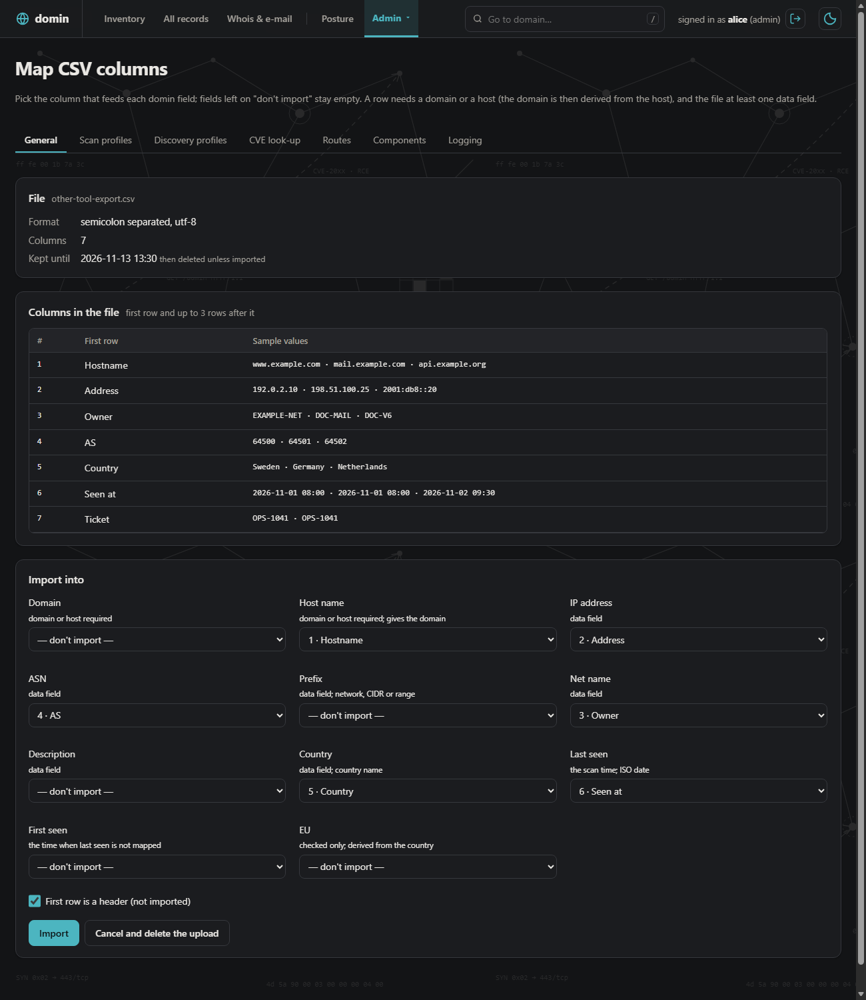 CSV import: map another tool's columns to domin's fields |
| 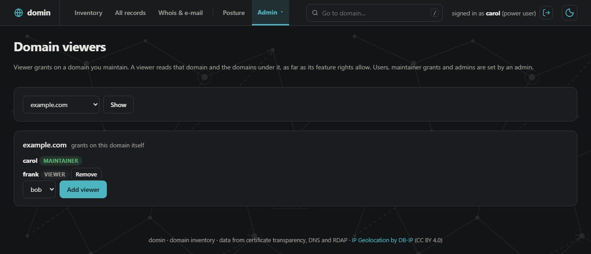 Domain viewers: a maintainer grants viewers on own domains |  Security posture, Overview: KPIs, CVEs over time |
|  Security posture, Analysis: attack surface, services, findings |  Analysis narrowed to one domain |
|  A host's services and a CVE opened: KEV, EPSS, exploit and PoC links | 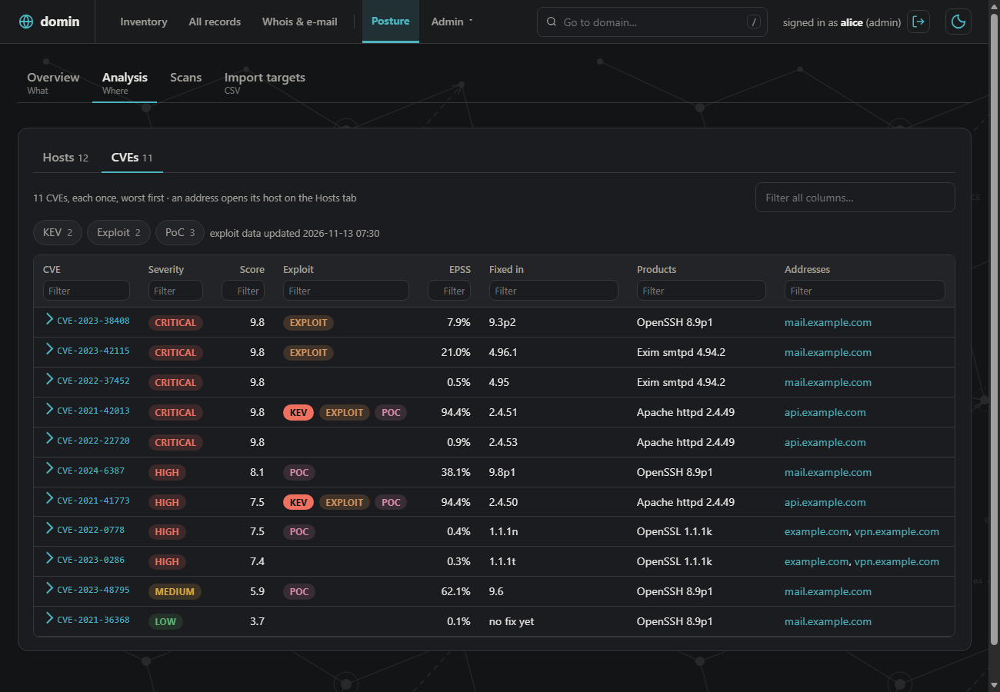 Analysis, CVEs tab: Exploit and EPSS columns, KEV / Exploit / PoC chips |
| 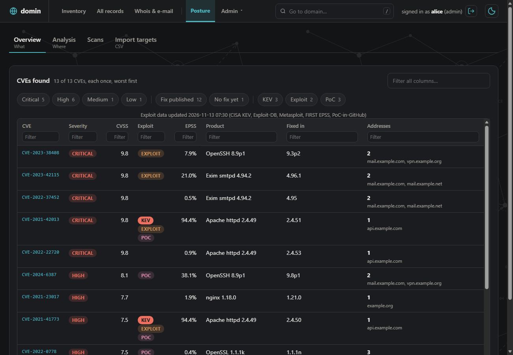 Overview, CVEs found: exploit data per CVE | 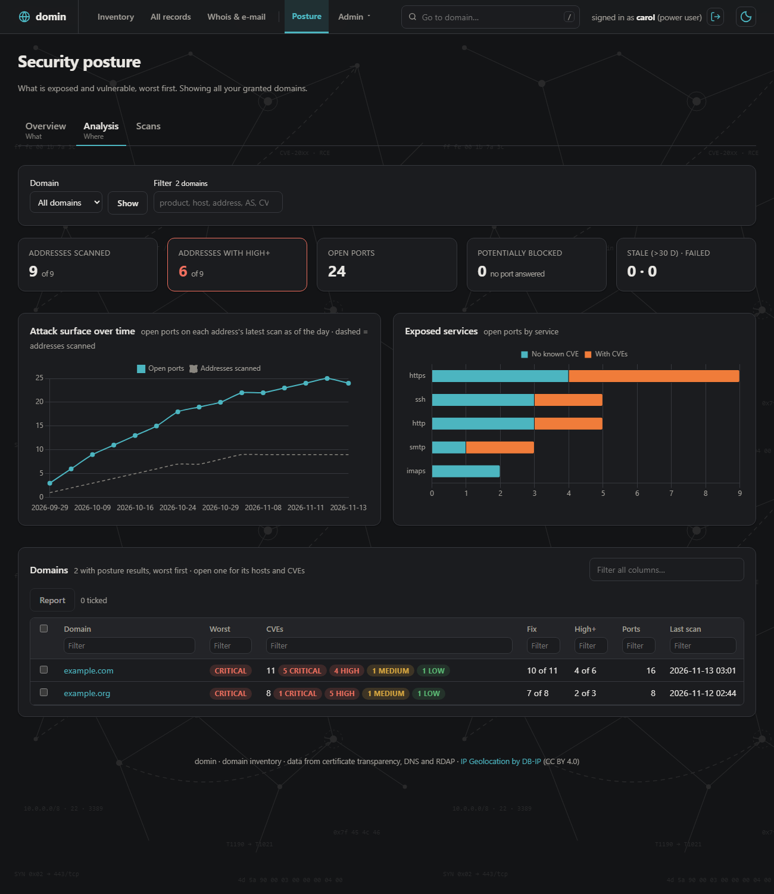 A power user sees only the granted domains |
|  Scans tab: posture scans and activity | 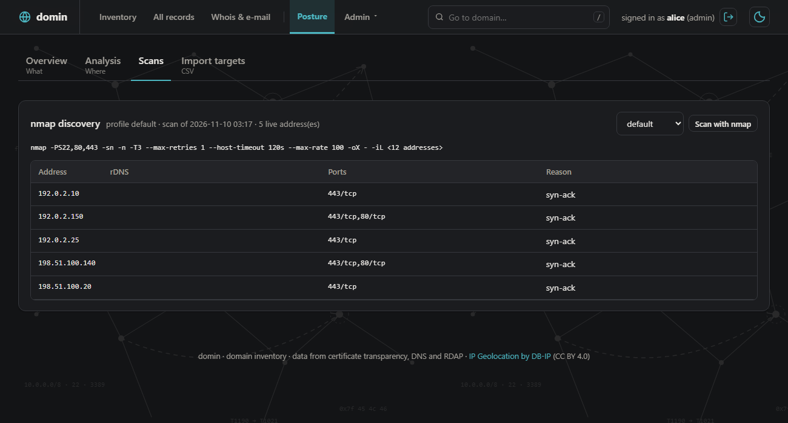 nmap discovery: live addresses, open ports, the command line |
| 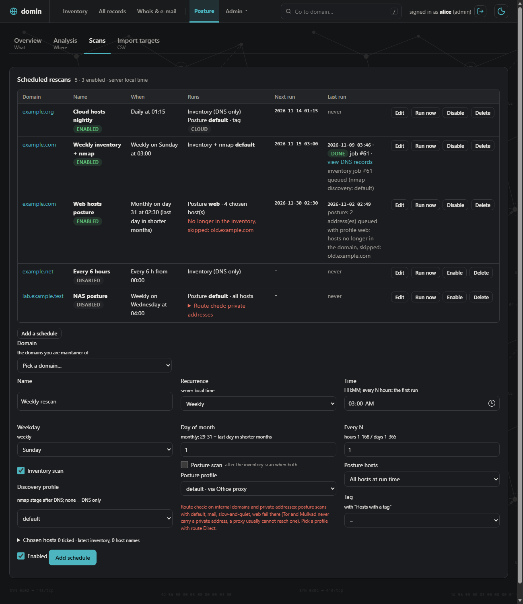 Scheduled rescans: inventory, nmap and posture, route check | 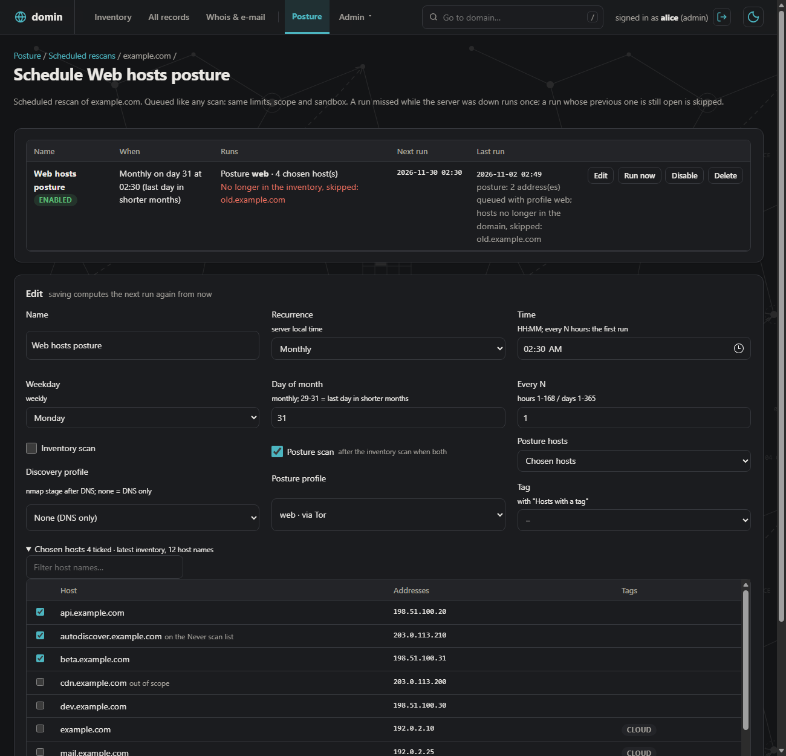 One schedule: recurrence, profiles, chosen hosts |
|  Scan profiles: ports, intensity, timing, route | 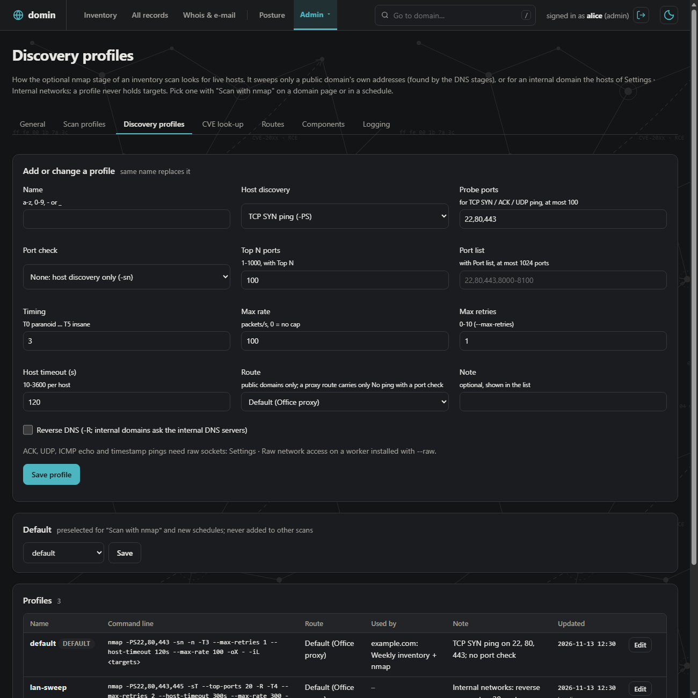 Discovery profiles: host discovery, port check, timing, route |
|  Routes: Direct, Tor, Mullvad, proxy per job type |  Settings: inventory scope, scan limits, internal domains |
|  Settings: posture scope, never scan, network tags | 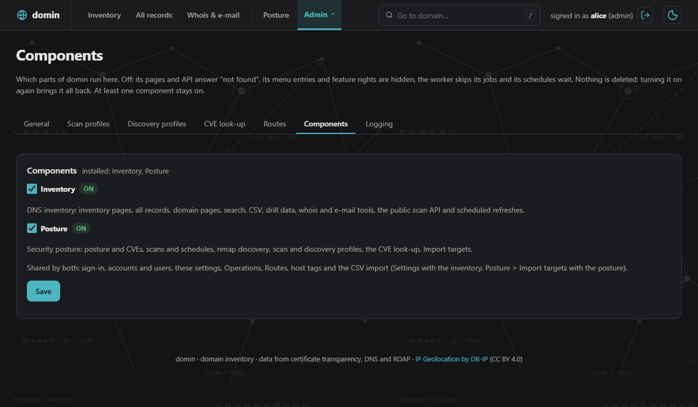 Components: inventory and posture on or off |
| 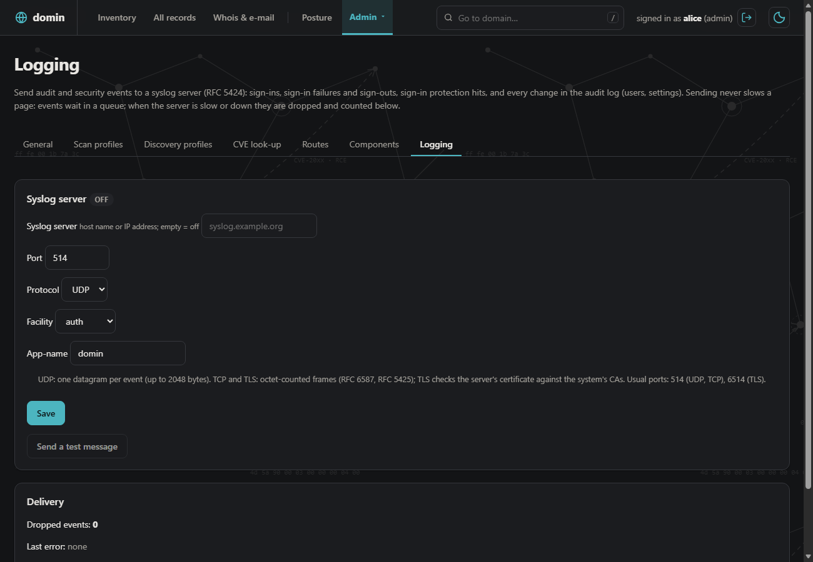 Logging: audit and security events to syslog (UDP, TCP, TLS) | 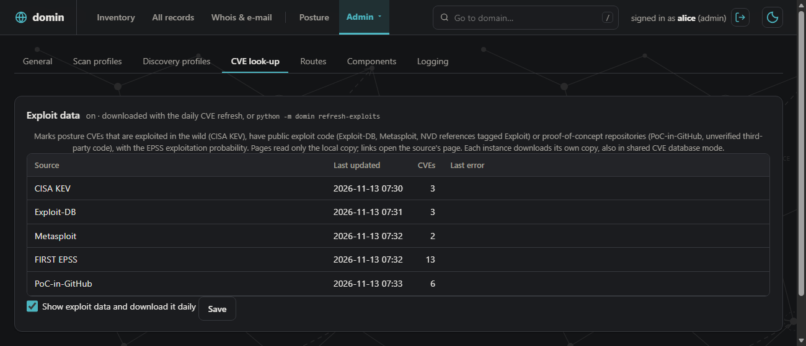 CVE look-up: exploit data sources, last update, on/off |
|  Admin dashboard: visits, usage, scan jobs, tuning |  Users: roles, two-factor |
| 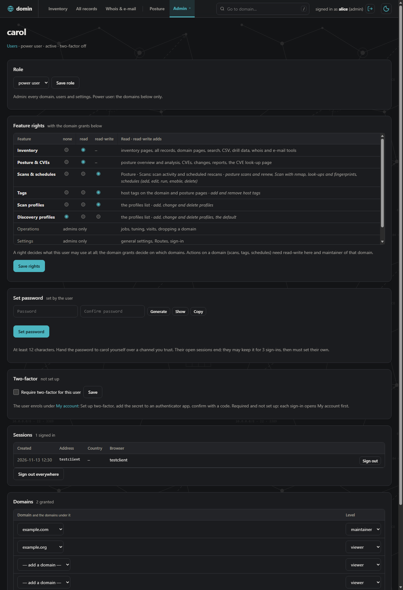 One user: role, feature rights, password, two-factor, sessions, domain grants |  Own account: password, two-factor |
|  Sign in (password, optional authenticator code) |  Light theme: overview |
|  Light theme: security posture | 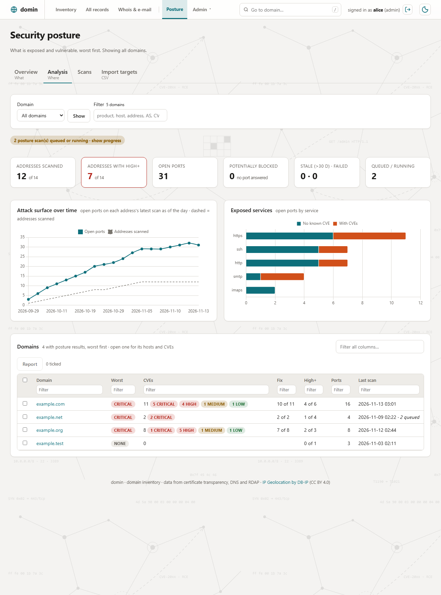 Light theme: posture analysis |
| 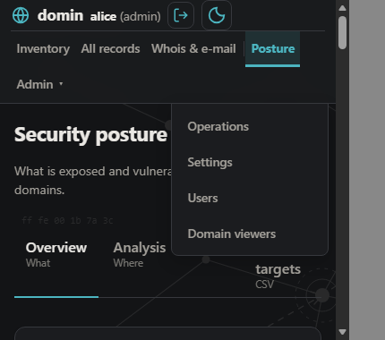 Phone width: header and Admin menu |  |

## Quick start
Public host (Debian 12/13 or Ubuntu 24.04, a DNS record for the host name), as root:

```bash
git clone https://github.com/andlin04/domin_ver2.git && cd domin_ver2
bash deploy/install.sh --domain domin.example.com --email you@example.com --firewall --ssh-from 203.0.113.0/24 \
  --admin-ip 203.0.113.10
```

On-prem host (no public name, self-signed TLS until you install a CA-signed certificate):

```bash
bash deploy/package.sh                        # build machine: dist/domin-VERSION-COMMIT.tar.gz + .sha256
sha256sum -c domin-*.tar.gz.sha256 && tar -xzf domin-*.tar.gz && cd domin-*/     # on the target
bash deploy/install.sh --internal --domain scanner.corp.example --scan-nets 10.0.0.0/8 \
  --internal-zones corp.example --internal-dns 10.0.0.53 --admin-user you
```

Main flags:

| Flag | Meaning |
| --- | --- |
| `--domain`, `--email` | Host name; Let's Encrypt account (public) |
| `--cloudflare`, `--origin-cert DIR` | Behind Cloudflare; Origin CA certificate with Authenticated Origin Pulls |
| `--internal` | On-prem mode |
| `--scan-nets`, `--internal-zones`, `--internal-dns` | On-prem scan reach and internal DNS |
| `--admin-ip`, `--admin-sources` | Network allowlists for `/admin` and (on-prem) the whole site |
| `--admin-user NAME` | Create the first admin (on-prem) |
| `--components inventory,posture` | Install one or both components (default both) |
| `--firewall`, `--ssh-from` | ufw with SSH, HTTP, HTTPS |
| `--raw` | nmap SYN scans (raw sockets for the worker only) |

Re-running `install.sh` updates in place (database, settings and certificates kept). First admin on a public host,
update, uninstall, Cloudflare, backup: [docs/INSTALL.md](docs/INSTALL.md).

## Requirements
- Debian 12/13 or Ubuntu 24.04 or newer, Python 3.12+, root for the installer; on-prem 2 CPU / 2 GB / 16 GB.
- The installer brings nginx, the pinned Python packages, amass, and with posture nmap, tor and wireguard-tools.
- Development: any OS with Python 3.12+ ([CONTRIBUTING.md](CONTRIBUTING.md)).

## Documentation

| Document | Contents |
| --- | --- |
| [docs/FEATURES.md](docs/FEATURES.md) | Every feature, grouped, with screenshots |
| [docs/INSTALL.md](docs/INSTALL.md) | Install, update, uninstall, all flags, Cloudflare, firewall, components, backup |
| [docs/CONFIGURATION.md](docs/CONFIGURATION.md) | Every `DOMIN_*` key, tuning, Settings pages |
| [docs/OPERATIONS.md](docs/OPERATIONS.md) | CLI commands, users, two-factor key rotation, services and logs |
| [docs/ARCHITECTURE.md](docs/ARCHITECTURE.md) | Processes, worker, database, sandboxing, root helpers, data flow |
| [docs/HARDENING.md](docs/HARDENING.md) | Security model in detail |
| [docs/delegation.md](docs/delegation.md), [docs/scheduled-scans.md](docs/scheduled-scans.md) | Design notes: roles and grants; schedules and nmap discovery |
| [CHANGES.md](CHANGES.md) | Change log, each entry with a rollback |
| [THIRD-PARTY-NOTICES.md](THIRD-PARTY-NOTICES.md) | Vendored files, external programs, data sources and their licenses |

## Security
Report vulnerabilities privately (GitHub Security tab > Report a vulnerability): [SECURITY.md](SECURITY.md).

## Legal disclaimer
- This tool is intended for internal use.
- Scan only systems and networks you own or are explicitly authorised in writing to test.
- Unauthorised scanning may be illegal.
- Provided as is, without warranty of any kind. You are responsible for compliance with applicable law and policy.

## License and status
- License: MIT ([LICENSE](LICENSE)). Third-party components: [THIRD-PARTY-NOTICES.md](THIRD-PARTY-NOTICES.md).
- Country data: [IP Geolocation by DB-IP](https://db-ip.com) (CC BY 4.0).
- Status: version 2.0.0, in production use; maintained by one person. Issues and pull requests welcome
  ([CONTRIBUTING.md](CONTRIBUTING.md)).
